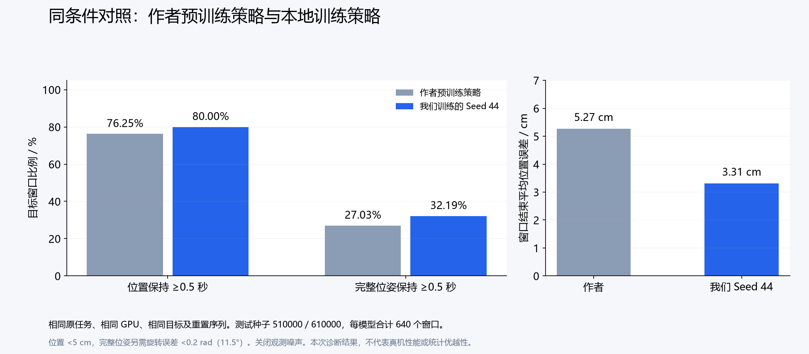
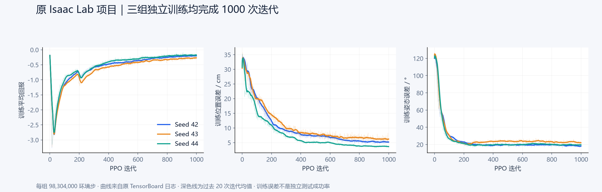
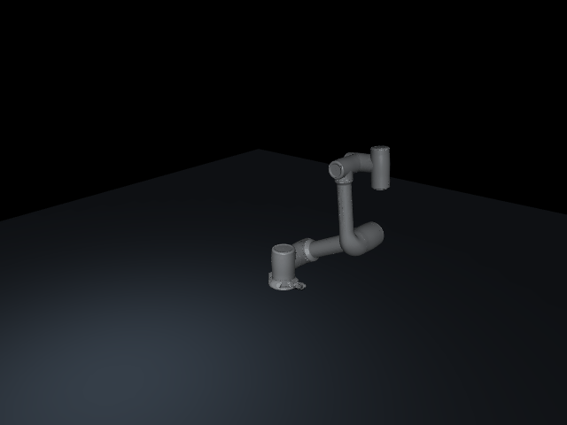
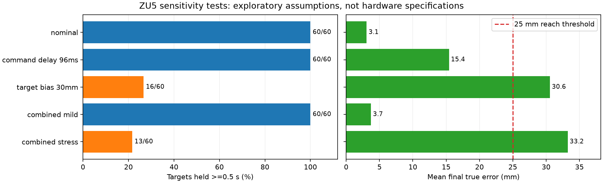
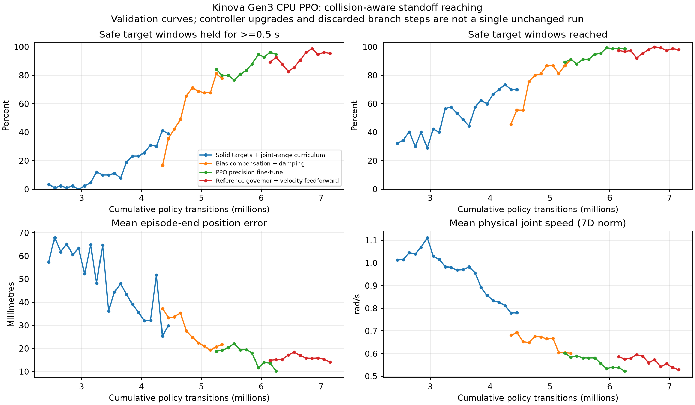

# 面向工业质检的机械臂强化学习与仿真验证

围绕机械臂目标到达、稳定停留与运动平稳性，开展强化学习训练、控制改进和独立评估。包含 Isaac Lab 原任务复现与 MuJoCo CPU 扩展两条路线，覆盖 Kinova Gen3 和 JAKA ZU5 模型。

当前完成的是工业质检应用所需的运动控制基础验证；未实现视觉缺陷检测、完整自主质检流程或真机部署。

## 核心结果

| 实验 | 测试范围 | 结果 |
| --- | --- | --- |
| Isaac Lab 公开策略对照 | 两组测试种子、640个配对目标窗口 | 本地 Seed 44 位置到达率 **85.00%**，作者公开模型 **79.38%**；窗口结束平均位置误差降低 **37.2%** |
| Kinova / MuJoCo 实体场景 | 两组独立测试、600个目标 | 安全到达 **592/600**；连续安全停留 **579/600（96.5%）** |
| JAKA / MuJoCo 连续任务 | 25条序列、675个目标 | 到达并停留 **675/675**；窗口结束平均误差 **2.98 mm**；最长每条连续 **5分钟** |
| JAKA 扰动敏感性 | 14种条件初筛，5种条件新目标复核 | 轻度组合复核停留 **60/60**；强组合 **13/60**，定位后续改进场景 |

不同任务的目标分布、阈值及碰撞条件不同，成功率不能跨任务直接排名。全部结果为限定条件下的仿真测量。

## 工程工作

- **训练与对标：**完成三个随机种子的 PPO 独立训练，每组98,304,000环境步，合计294,912,000步；核验作者公开模型，与选定本地策略按相同目标和重置序列比较。
- **控制改进：**在 MuJoCo 分支扩展实体碰撞场景与控制状态观测，结合参考轨迹限速、限加速度、动力学偏置补偿与速度前馈，处理受阻时参考位置持续积累的问题。
- **评估设计：**区分“曾到达”“连续保持”和“窗口结束误差”，分离训练验证与独立测试，保留逐目标数据及失败结果。
- **模型适配：**完成国产六轴机械臂模型转换、运动学一致性检查，扩展无重置连续任务及噪声、时延、参数偏差评估。

设计与验证细节见[工程说明](docs/engineering.md)，统计口径见[实验协议](docs/experiments.md)。本仓库按工作模块展示，不推定团队内部的个人独立贡献。

## 可视化

### Isaac Lab 同条件对照



本地策略为选定的 Seed 44。位置与完整位姿保持率在本次测试中较高，全过程平均姿态误差与作者模型接近。该结果不证明训练方法普遍优于原作者。

<details>
<summary>三个随机种子的训练曲线</summary>



</details>

### 连续目标控制



展示四个目标、16秒仿真片段；循环回放时返回起点。小球是无碰撞目标标记。

[Kinova 原生模型轨迹回放（MP4）](assets/videos/kinova-isaaclab-replay.mp4)：原 Isaac Lab 记录轨迹在独立 Isaac Sim 6.0 中渲染，不代表物理控制任务已迁移至6.0。

<details>
<summary>扰动复核与 CPU 训练曲线</summary>





CPU曲线包含控制器升级、候选回退和不同阶段训练，不是固定配置下的单一连续实验。

</details>

## 浏览与复现

- [实验协议及结果边界](docs/experiments.md)
- [工程问题与技术决策](docs/engineering.md)
- [运行与复现说明](docs/reproduction.md)
- [原始状态、逐目标数据与汇总](results/)
- [来源、许可证与发布范围](NOTICE.md)

仅核对指标不需要机器人或仿真环境：

```bash
python tools/verify_results.py
```

源码位于 `simulations/`。Kinova模型资产附带上游许可证；JAKA官方模型与厂商SDK不随仓库分发，JAKA仿真需先从上游重建模型。

结果记录日期：2026年10月14日至29日；发布整理日期：2026年11月4日。
