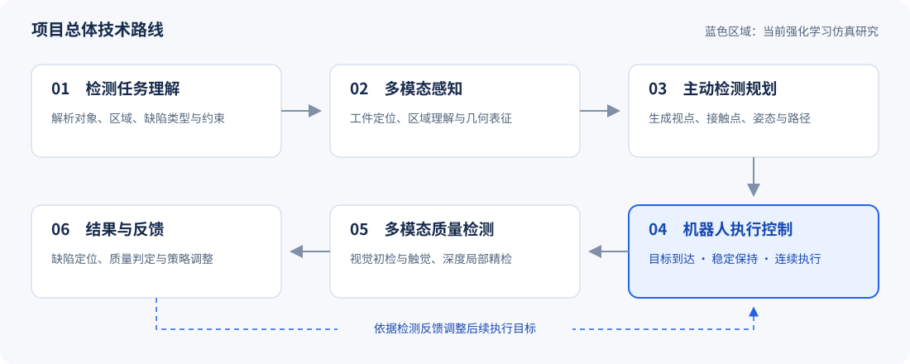
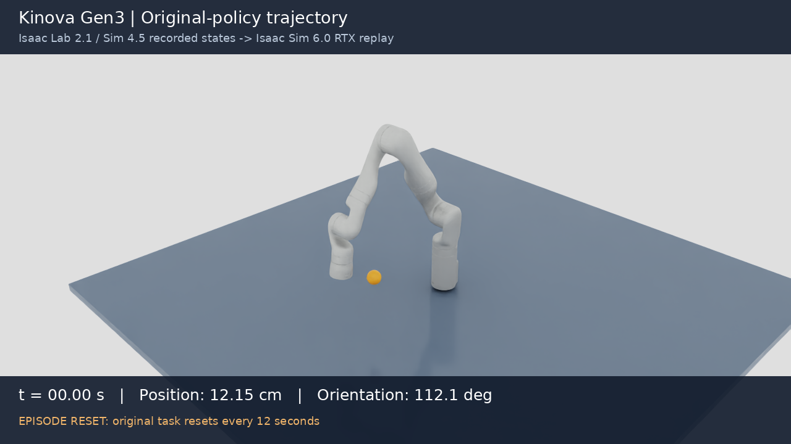

<div align="center">

# 面向工业质检的具身智能机器人

**关键技术与系统研发**

机械臂强化学习控制与仿真验证

[项目概述](#项目概述) · [技术定位](#技术定位) · [阶段性成果](#阶段性成果) · [工程方法](#工程方法) · [真机部署计划](#真机部署计划)

</div>

## 项目概述

本项目面向多品种工业零部件的柔性质检需求，以构建具备**任务理解、主动检测规划、机器人执行和多模态质量判定**能力的具身智能机器人系统为目标。总体方案根据检测指令识别工件及目标区域，结合工件几何、表面法向和传感器工作距离生成检测点与路径，协同利用视觉、触觉和深度信息开展检测，并根据结果反馈调整后续检测策略。

现阶段研究聚焦**机械臂执行控制与仿真验证**。依托 Isaac Lab 和 MuJoCo 两条仿真路线，开展强化学习策略训练、公开模型对照、控制机制优化、国产机械臂模型适配及扰动敏感性评估，为真机部署与检测任务集成提供实验依据。



## 技术定位

强化学习研究对应总体技术路线中的**机器人执行控制环节**：将上层规划给定的检测目标转化为关节参考动作，配合参考轨迹生成与底层动力学控制，研究末端到达、位姿保持和连续目标执行能力。

| 应用环节 | 执行要求 | 对应研究内容 |
| --- | --- | --- |
| 视觉检测视点定位 | 到达指定观测位置，并满足姿态与工作距离要求 | 位置与完整位姿的到达、连续保持评估 |
| 触觉精检前定位 | 平稳接近目标区域，并保持受约束的停留状态 | 目标前间隙、实体场景约束与低速停留 |
| 多检测点连续执行 | 连续切换检测目标，并保留物理状态与控制历史 | 无重置连续控制、长序列验证与扰动评估 |

本项目所述**检测点稳定停靠**，指机械臂末端在指定检测位置附近达到并持续保持所需状态。后续将结合工具坐标、传感器工作距离和数据采集时长，建立面向实际检测工位的控制与验收指标。

## 阶段性成果

### 基准对照与训练验证

完成 3 个随机种子的近端策略优化（PPO）独立训练，每组 **98,304,000 个环境步**，合计 **294,912,000 个环境步**。选定的本地策略（训练种子：44）与原项目公开预训练策略，在相同任务配置、目标序列及重置时序下开展配对评估。

| 评估指标 | 原项目公开预训练策略 | 本地训练策略 |
| --- | ---: | ---: |
| 位置到达率 | 79.38% | **85.00%** |
| 位置保持率 | 76.25% | **80.00%** |
| 完整位姿保持率 | 27.03% | **32.19%** |
| 目标窗口结束时的平均位置误差 | 5.269 cm | **3.311 cm** |

在 **640 个配对目标窗口**中，本地策略的位置到达率由基准的 79.38% 提高至 **85.00%**，目标窗口结束时的平均位置误差降低 **37.2%**。


<details>
<summary><b>训练曲线与评估条件</b></summary>


评估采用确定性策略并关闭观测噪声，测试种子分别为 510000 和 610000。两种策略共用 640 个配对目标窗口；位置误差阈值为 5 cm，完整位姿另要求旋转误差小于 0.2 rad，连续保持时间至少为 0.5 s。本地策略依据此前评估选定；全过程平均姿态误差分别为本地策略 32.556°、基准策略 32.574°。详细统计定义与选模过程见[实验协议](docs/experiments.md)。

</details>

### 控制优化与连续任务验证

| 仿真任务 | 评估规模 | 主要结果 |
| --- | --- | --- |
| Kinova Gen3 实体场景 | 2 组独立测试，共 600 个目标 | 安全到达 **592 / 600（98.7%）**；连续安全停留 **579 / 600（96.5%）** |
| JAKA ZU5 连续目标控制 | 25 条序列，共 675 个目标 | 到达并停留 **675 / 675**；窗口结束时的平均位置误差为 **2.98 mm** |
| JAKA ZU5 扰动敏感性评估 | 14 种条件初筛、5 种条件的新目标复核 | 覆盖测量噪声、指令与观测时延、坐标偏差及动力学参数变化 |

各项结果对应独立的仿真场景、目标分布和判定条件，任务设置及指标定义见[实验协议](docs/experiments.md)。

<details>
<summary><b>扰动复核与分阶段训练记录</b></summary>


轻度组合扰动条件下，60 / 60 个目标满足连续停留条件；强组合扰动条件下为 13 / 60。目标坐标偏差为 30 mm 时，目标窗口结束时满足位置阈值的目标数为 0 / 60。上述结果为坐标标定、通信时序分析和控制参数优化提供了诊断依据。


曲线保留实际开发过程中的控制器升级、候选模型回退及续训记录。各阶段配置见[工程说明](docs/engineering.md)。

</details>

### 仿真演示

**JAKA ZU5 连续目标控制**


演示展示 4 个目标、共 16 s 的仿真过程，序列内部保留机器人状态。目标采用无碰撞位置标记；动图循环时返回片段起点。完整连续评估累计 45 min 模拟时间，单条序列最长为 5 min。

**Kinova Gen3 原生模型轨迹回放**

[](assets/videos/kinova-isaaclab-replay.mp4)

[播放 24 s 轨迹回放（MP4）](assets/videos/kinova-isaaclab-replay.mp4)。回放使用 Isaac Lab 2.1 与 Isaac Sim 4.5 环境中记录的物理状态，在独立的 Isaac Sim 6.0 环境中进行 RTX 渲染；训练、轨迹采集与可视化展示分别记录。

## 工程方法

围绕检测点稳定停靠，从**轨迹参考、动力学响应、测量误差和任务判定**四个方面分解问题，通过控制改进、独立评估与回归验证形成可追溯的实验过程。

| 工程问题 | 技术措施 | 验证依据 |
| --- | --- | --- |
| 短时到达难以反映持续保持能力 | 分别定义到达率、连续保持率和窗口结束误差 | 逐目标统计与独立测试种子复核 |
| 受阻时参考位置积累，释放后产生动作突变 | 限制参考跟踪误差，并引入限速、限加速度的参考轨迹 | 阻挡释放回归案例与实际关节速度记录 |
| 控制响应与场景约束相互影响 | 将状态观测由 28 维扩展至 42 维，结合偏置补偿、速度前馈与共享力矩限幅 | 实体球、桌面等场景中的到达和连续停留评估 |
| 连续目标与参数偏差影响执行稳定性 | 保留控制历史，分离目标采样与扰动采样 | 长序列测试、同目标条件对照与新目标复核 |

原始状态、逐目标结果、模型哈希与核验脚本共同构成实验记录。具体设计及技术决策见[工程说明](docs/engineering.md)。

## 真机部署计划

下一阶段将推进 **JAKA ZU5 真机部署与检测点稳定停靠验证**，按照“测量、建模、改进、复核”的工程流程开展联调。

1. **坐标与工具标定。** 核对机器人零位、工具中心点（TCP）和工具负载，完成传感器、工件与机器人之间的坐标标定，统一检测点与末端执行目标。
2. **控制链路测量。** 核对控制器及软件开发工具包（SDK）接口，记录指令发送、状态反馈与实际跟踪响应，设置速度、加速度和中断处理约束。
3. **稳定停靠优化。** 针对目标附近振荡、受阻参考积累、坐标偏差及通信时延，分析关节与末端时序数据，改进参考轨迹、控制参数与策略。
4. **检测工位验证。** 以位置与姿态误差、连续保持时长、超调量、稳定时间及重复性为评价依据，逐步接入检测点生成、视觉采集和触觉精检前定位流程。

## 代码与复现

| 材料入口 | 内容 |
| --- | --- |
| [仿真代码](simulations/) | Kinova Gen3 与 JAKA ZU5 的训练、控制、评估和回归测试 |
| [实验数据](results/) | 配对原始状态、逐目标记录、扰动结果与来源信息 |
| [实验协议](docs/experiments.md) | 任务设置、指标阈值、选模过程与统计定义 |
| [运行说明](docs/reproduction.md) | 环境配置、模型准备与评估命令 |
| [验证记录](VALIDATION.md) | 已执行的数据核验与代码测试 |
| [来源与许可](NOTICE.md) | 上游项目、模型资产及发布范围 |

```bash
# 使用 Python 标准库核对发布指标与文件哈希
python tools/verify_results.py

# 使用 NumPy 从原始状态数组重新统计
python tools/verify_results.py --raw
```

实验记录：2026 年 10 月 14 日至 29 日；材料整理：2026 年 11 月 4 日。
